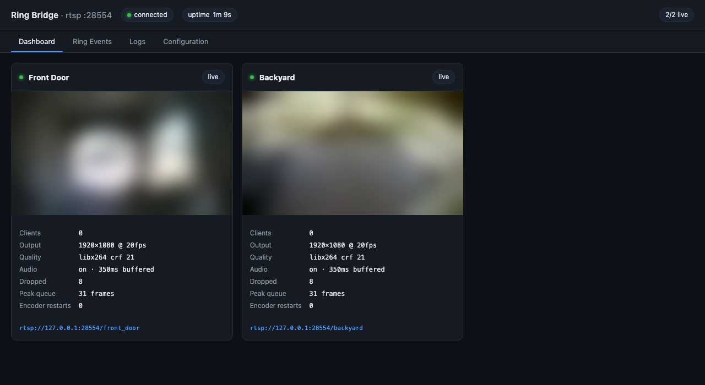

# ring-bridge

Turn Ring cameras into a stable RTSP stream for Frigate and other NVRs — with a stream
that never drops, even while Ring is reconnecting.



## Why this exists

Ring has no RTSP endpoint. Live view is a WebRTC call that Ring's servers tear down after
about twelve minutes, and a camera can be unreachable for much longer. Publish that
straight to RTSP and your NVR loses the stream every few minutes.

ring-bridge serves RTSP from its own process and feeds it with a fixed-rate frame clock:

- **Ring is up** → live video and audio pass through.
- **Ring is down** → the last frame it saw, dimmed, with an animated spinner on top.
- **Ring comes back** → live video takes over mid-stream.

The RTSP session is never torn down, so clients see one continuous feed and never
reconnect. It also runs its own RTSP server, so there is no MediaMTX or go2rtc to install.

## Requirements

- Node.js 22 or newer
- `ffmpeg` on your `PATH`
- A Ring account with at least one camera

## Setup

**1. Install**

```sh
git clone https://github.com/kevinelliott/ring-bridge.git
cd ring-bridge
npm install
```

**2. Get a Ring refresh token**

```sh
npx -p ring-client-api ring-auth-cli
```

It asks for your Ring email, password, and 2FA code, then prints a token.

**3. Save it**

```sh
cp .env.example .env
# paste the token into RING_REFRESH_TOKEN
```

Ring rotates this token and invalidates the old one, so the bridge writes each new value
back to `.env` automatically. Keep the file writable and never commit it.

**4. Check your cameras**

```sh
npm start
```

```
Ring locations (1)

Home  (abc123-xyz) — 2 cameras
  ├─ Front Door  Doorbell Elite  wired  online
  └─ Backyard    Floodlight Cam  wired  offline
```

**5. Run the bridge**

```sh
npm run bridge
```

```
RTSP server listening on 0.0.0.0:8554
[Front Door] publishing to rtsp://<host>:8554/front_door
Admin dashboard on http://0.0.0.0:8080
[Front Door] Ring live, taking over output
```

Each camera is served at `rtsp://<host>:8554/<camera_name_slugified>` — `Front Door`
becomes `front_door`. Verify with any RTSP client:

```sh
ffplay -rtsp_transport tcp rtsp://localhost:8554/front_door
```

## Connect it to your NVR

### Frigate

Add each camera to your `config.yml`:

```yaml
cameras:
  front_door:
    ffmpeg:
      inputs:
        - path: rtsp://<bridge-host>:8554/front_door
          input_args: preset-rtsp-generic
          roles: [detect, record, audio]
    detect:
      width: 1920
      height: 1080
      fps: 5
```

Notes:

- Use the machine's LAN IP for `<bridge-host>`. If Frigate runs in Docker on the same
  host, `host.docker.internal` works on Docker Desktop; on Linux use the host IP.
- Keep `detect.fps` low. 5 is plenty — the bridge delivers 20.
- Start order does not matter. Because the stream is always up, Frigate connecting before
  Ring is reachable gets the placeholder rather than a refused connection.
- Drop `audio` from `roles` if you run with `--no-audio`.

### Other NVRs

The output is standard RTSP (H.264 + AAC) over TCP or UDP, so anything that accepts an
RTSP URL should work — Blue Iris, Scrypted, Shinobi, ZoneMinder, go2rtc. Recipes for
those are coming; open an issue if you get one working and want it documented.

## Dashboard

`http://<bridge-host>:8080` — four tabs:

| Tab | What's there |
| --- | --- |
| **Dashboard** | Live preview per camera, connection state, client count, output settings, queue health |
| **Ring Events** | Doorbell presses, motion, person detection — live and backfilled from Ring history |
| **Logs** | Everything the bridge prints, streamed live, with filtering |
| **Configuration** | Change resolution, frame rate, encoder, and quality without dropping clients |

Applying a configuration change restarts the encoder, and **connected clients keep their
RTSP session** — the server rewrites RTP headers across the restart so the change is
invisible downstream.

`on_demand` events are hidden by default in the Events tab, because every time the bridge
dials Ring it creates one — they are mostly the bridge's own activity, not real events.

### Securing the dashboard

The dashboard binds to `0.0.0.0` and **read access is unauthenticated** — anyone who can
reach the port can watch previews, logs, and events. Options:

```sh
npm run bridge -- --web-token "some-secret"   # require a token for changes
npm run bridge -- --web-bind 127.0.0.1        # local only, reach it over SSH
npm run bridge -- --no-web                    # turn it off entirely
```

There is no TLS. Put it behind a reverse proxy if it needs to leave your LAN.

## Configuration

All options are CLI flags:

```sh
npm run bridge -- [options]
```

| Flag | Default | Description |
| --- | --- | --- |
| `--port <n>` | `8554` | RTSP listen port |
| `--camera "Name"` | all | Bridge only this camera; repeatable |
| `--size WxH` | `1920x1080` | Output resolution |
| `--fps <n>` | `20` | Output frame rate |
| `--encoder <name>` | `libx264` | Video encoder |
| `--crf <n>` | `21` | Quality, lower is better (libx264/libx265) |
| `--preset <name>` | `veryfast` | x264 preset |
| `--bitrate <kbps>` | — | Target bitrate; overrides `--crf` |
| `--no-audio` | — | Publish video only |
| `--web-port <n>` | `8080` | Dashboard port |
| `--web-bind <addr>` | `0.0.0.0` | Dashboard bind address |
| `--web-token <s>` | — | Require a token for config changes |
| `--no-web` | — | Disable the dashboard |

### Running it as a service

```ini
# /etc/systemd/system/ring-bridge.service
[Unit]
Description=Ring Bridge
After=network-online.target

[Service]
WorkingDirectory=/opt/ring-bridge
ExecStart=/usr/bin/npm run bridge
Restart=always
RestartSec=10
User=ring

[Install]
WantedBy=multi-user.target
```

## Resolution and quality

**Ring's stream is the ceiling.** A Doorbell Elite sends 1920x1080 H.264 at 20fps, around
2.3 Mbps, and its live-view preset is already set to `highest`. There is no
higher-resolution source to request, and `--size` larger than the camera's native
resolution just upscales.

Lowering `--crf` below about 20 mostly spends bandwidth reproducing Ring's own compression
artifacts — measured SSIM barely moves while bitrate climbs 50%.

CPU is the real cost. Mixing live video with the placeholder requires decoding and
re-encoding, so budget roughly one modern core per 1080p20 camera at
`libx264 -preset veryfast`. To reduce it:

```sh
npm run bridge -- --fps 10                        # halve the frame rate
npm run bridge -- --size 1280x720                 # smaller output
npm run bridge -- --encoder h264_videotoolbox --bitrate 6000   # macOS hardware encoder
```

On Linux, try `h264_qsv` (Intel), `h264_nvenc` (NVIDIA), or `h264_v4l2m2m` (Raspberry Pi).
Hardware encoders ignore `--crf`, so pass `--bitrate`.

## Troubleshooting

**`Missing RING_REFRESH_TOKEN`** — `.env` is missing or empty. See Setup step 3.

**401 / auth errors on startup** — the token expired or was invalidated. Generate a new
one with `ring-auth-cli`. This should not happen while the bridge is running, since it
persists rotated tokens automatically.

**Stream connects but shows only the spinner** — Ring is not reachable for that camera.
Check the Logs tab; `Ring stream error` lines show why. Cameras that report `offline` in
`npm start` may still stream intermittently.

**Dropped frames climbing** — the encoder cannot keep up. Check `Peak queue` on the camera
card; if it sits at the ceiling, lower `--fps` or `--size`, or use a hardware encoder.
In steady state dropped frames should read `0`.

**Colors look washed out** — should not happen; the encoder tags BT.709 limited range
explicitly. Verify what your client resolved:

```sh
ffprobe -rtsp_transport tcp -show_entries stream=color_range,color_space \
  rtsp://<bridge-host>:8554/front_door
```

**More detail** — run with `DEBUG=ring` to see the library's internals and full ffmpeg
stderr.

## Things worth knowing

- **Continuous streaming is not what Ring's live view is designed for.** Wired cameras are
  fine, but battery models will drain quickly — this is not a good fit for those.
- Ring may rate-limit sustained live-view usage. There is no documented quota.
- Every reconnect appears in your Ring event history as an `on_demand` event.
- Audio is resampled to 16 kHz mono AAC, which is what Frigate's audio detection expects.

## How it works

```
Ring (WebRTC) ──ffmpeg decode──▶ raw frames ──┐
                                              ├──▶ frame clock ──▶ encoder ──▶ RTSP server
       last frame + spinner (during outage) ──┘
```

A fixed-rate clock drives the output, decoupling it from Ring's availability. Audio rides
the same clock — every tick writes one video frame and exactly `16000 / fps` samples — so
A/V stays in sync by construction rather than by timer accuracy.

The RTSP server rewrites RTP sequence numbers, timestamps, and SSRC, giving the stream one
continuous identity no matter how many times the encoder restarts underneath. It also
sniffs H.264 SPS/PPS off the wire and advertises them as `sprop-parameter-sets`, so a
client joining mid-GOP decodes immediately.

| File | Role |
| --- | --- |
| `frigate-bridge.ts` | Entry point, Ring supervision, wiring |
| `rtsp-server.ts` | RTSP server: RTP fan-out, SDP, header rewriting |
| `continuous-publisher.ts` | Frame clock, encoder lifecycle, A/V mixing |
| `spinner.ts` | Placeholder compositing in yuv420p |
| `ring-auth.ts` | Token loading and rotation persistence |
| `ring-events.ts` | Ring event collection |
| `admin-server.ts` | Dashboard HTTP API and SSE |
| `log-bus.ts` | Console capture for the dashboard |
| `ring.ts` | Standalone camera lister |

## Development

```sh
npm run typecheck
```

Built on [ring-client-api](https://github.com/dgreif/ring). Not affiliated with Ring or
Amazon.
